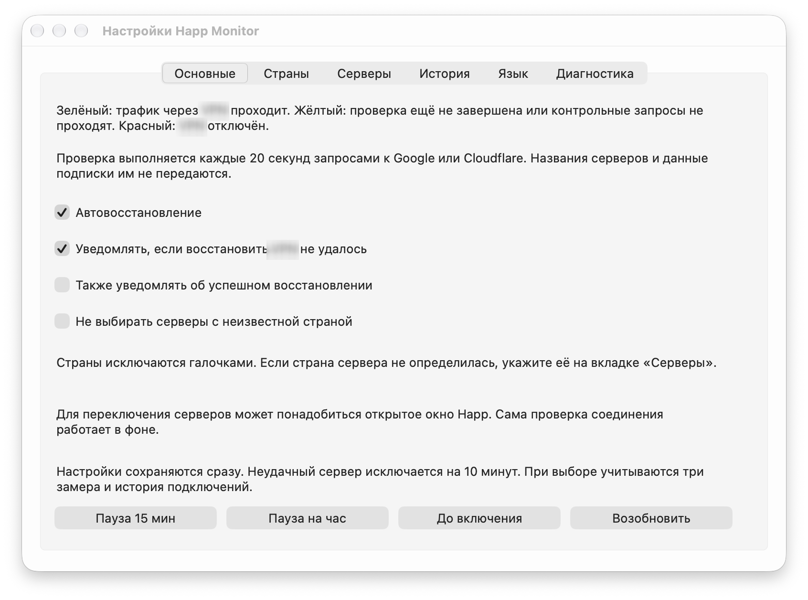
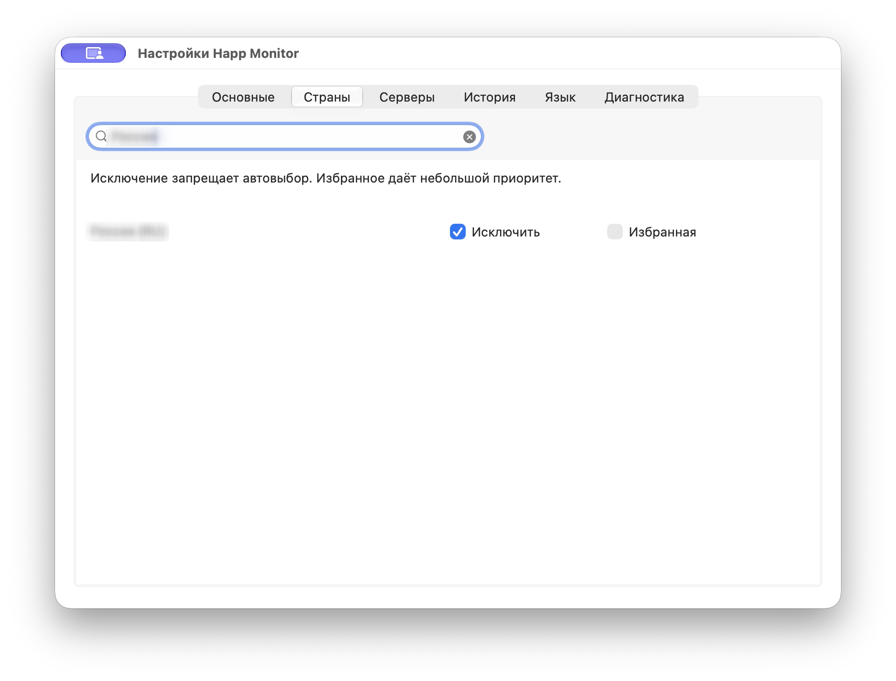
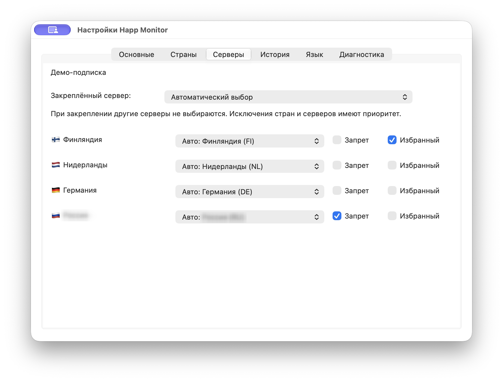
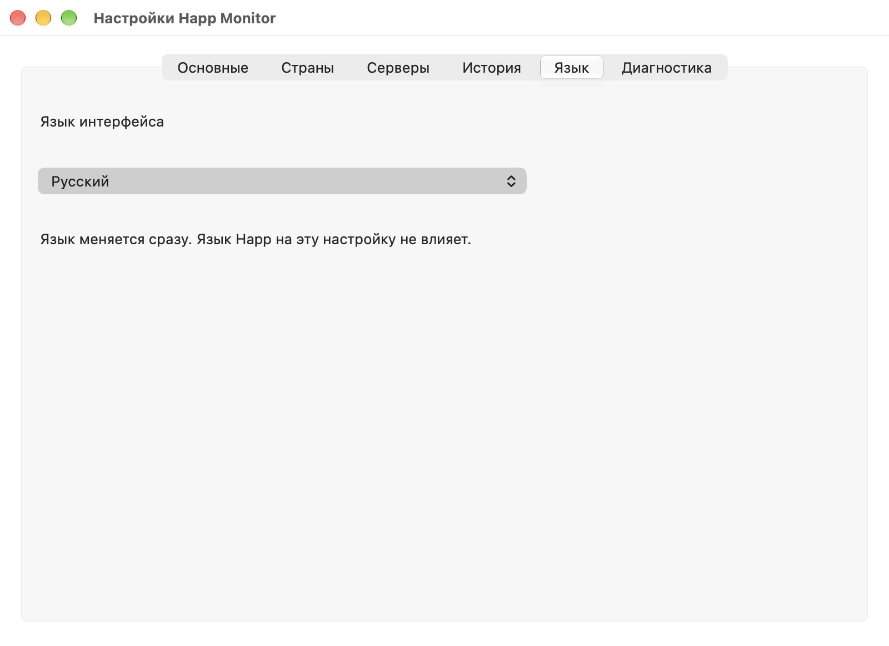
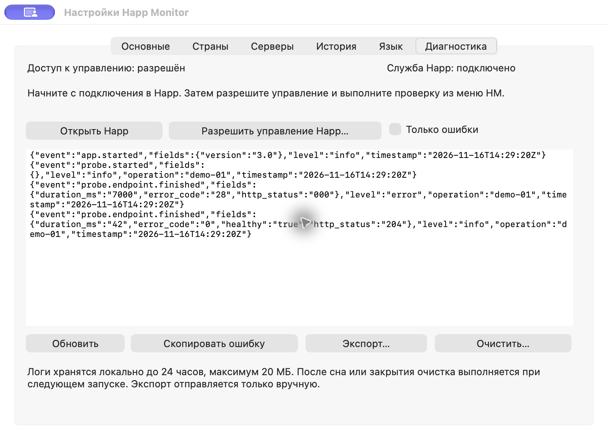
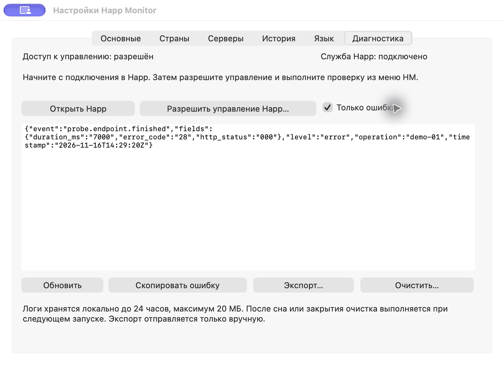
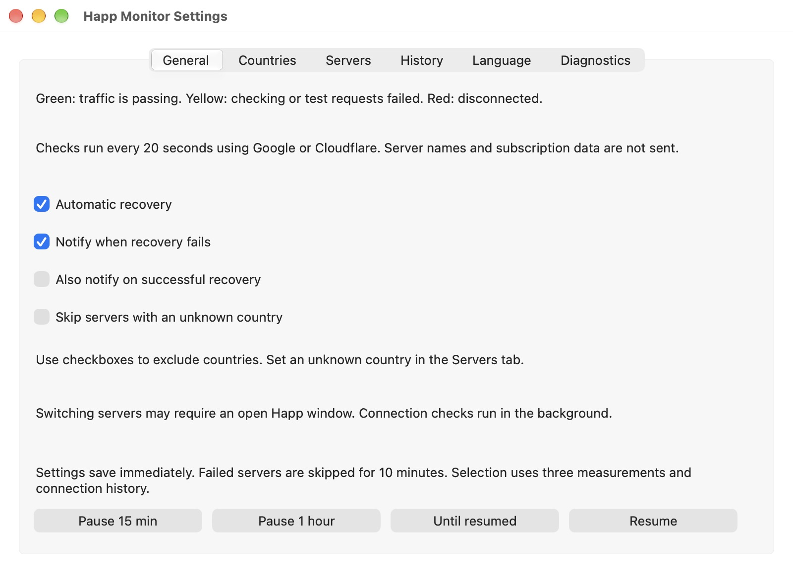
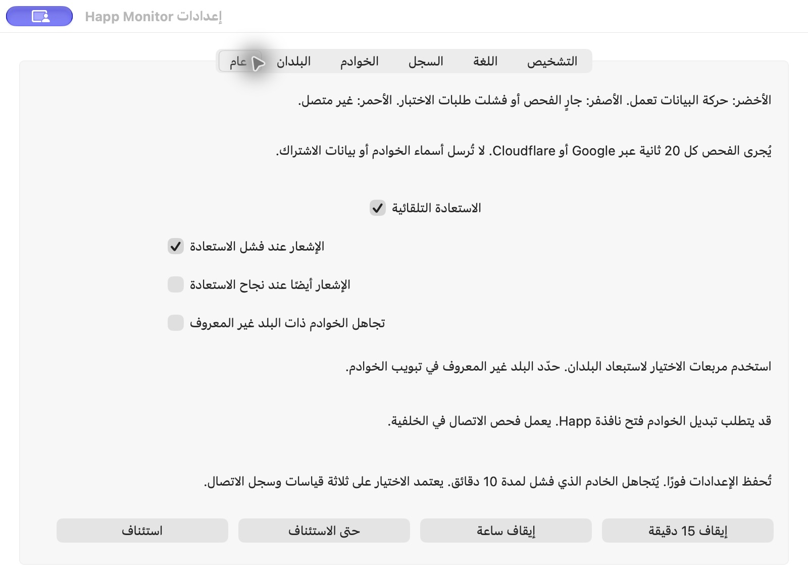
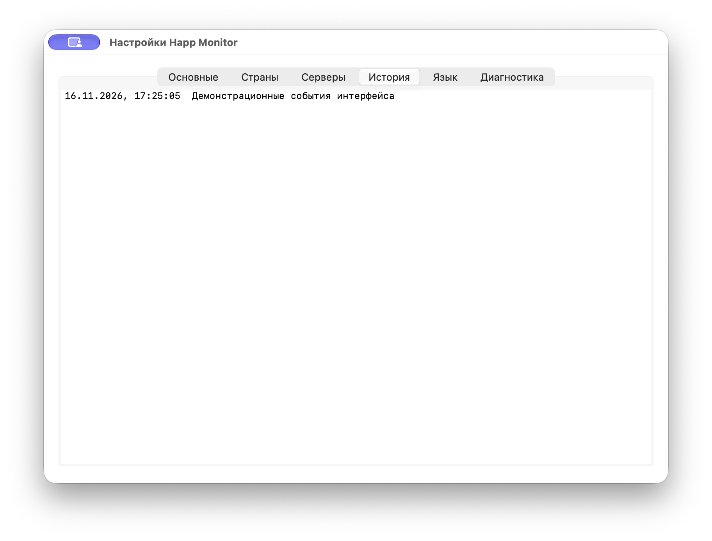

<p align="center">
  
</p>

<p align="center">
  <a href="https://github.com/DenisZhutaev/happ-monitor/actions/workflows/ci.yml"></a>
  
  
</p>

**Happ Monitor** следит за подключением Happ, показывает состояние соединения в строке меню Mac и помогает восстановить его после сбоя. Зелёный индикатор появляется после успешного контрольного запроса через туннель.

Приложение написано на Swift и AppKit. Настройки и история хранятся на Mac. Для сборки не нужны сторонние библиотеки.

## Обновление 3.0

- Интерфейс на русском, английском, китайском (упрощённое письмо), испанском, французском и арабском. Выбор: **Настройки → Язык**. Есть вариант «Как в macOS». Язык меняется сразу; для арабского отражены строки настроек и выровнен текст справа.
- Режим автоматизации показан отдельно от состояния соединения. При паузе рядом с HM появляется **Ⅱ**, а действие «Возобновить» вынесено в начало меню.
- Рядом с недоступными действиями указана причина. Во время восстановления видны этап, прошедшее время и отмена. Отмена останавливает подбор; автоматическая повторная попытка возможна через две минуты.
- Вкладка **Диагностика** показывает доступ к управлению, состояние службы и технический журнал. Доступны фильтр ошибок, копирование последней ошибки, предварительный просмотр экспорта и очистка с подтверждением.
- Журнал хранится локально в `~/Library/Logs/Happ Monitor/`. Записи старше 24 часов удаляются при запуске, пробуждении и примерно раз в минуту во время работы. Если приложение закрыто или Mac спит, очистка выполняется после следующего запуска или пробуждения. Общий объём ограничен 20 МБ.
- В журнале есть идентификаторы попыток, этапы, длительность, HTTP-статусы и коды завершения проверки. Ключи, ссылки подписок, адреса серверов и их названия не записываются. Для кандидатов используются случайные идентификаторы в пределах попытки. Файлы доступны только текущему пользователю; отчёт сохраняется и передаётся только по его действию.

При первом запуске открывается диагностика с подсказками. **Язык интерфейса монитора не меняет язык Happ:** переключение серверов по-прежнему использует команды его русскоязычного интерфейса.

Галерея и GIF ниже показывают версию 3.0: меню с паузой, выбор языка, арабский интерфейс и диагностику с фильтром ошибок.

## Меню и настройки в действии

<p align="center">
  
</p>

Анимация собрана из снимков интерфейса с демонстрационной подпиской и событиями. Верхняя панель показана схематично, чтобы оставить в кадре только HM и меню. Зелёный штрих означает, что проверка трафика прошла.

<details>
<summary>Рассмотреть отдельные экраны</summary>

[Меню в строке macOS](docs/assets/screenshots/menu-bar.png)

| Основные | Страны | Серверы |
|:---:|:---:|:---:|
| [](docs/assets/screenshots/settings-general.png) | [](docs/assets/screenshots/settings-countries.png) | [](docs/assets/screenshots/settings-servers.png) |
| **Язык** | **Диагностика** | **Только ошибки** |
| [](docs/assets/screenshots/settings-language.png) | [](docs/assets/screenshots/settings-diagnostics.png) | [](docs/assets/screenshots/settings-errors.png) |
| **English** | **العربية** | **История** |
| [](docs/assets/screenshots/settings-english.png) | [](docs/assets/screenshots/settings-arabic.png) | [](docs/assets/screenshots/settings-history.png) |

Нажмите миниатюру, чтобы открыть полный снимок.

</details>

## Что умеет

| Возможность | Как работает |
| --- | --- |
| Проверяет трафик | Выполняет HTTPS-запрос через интерфейс Happ каждые 20 секунд. |
| Восстанавливает соединение | Подбирает разрешённый сервер по трём замерам, затем проверяет трафик. |
| Учитывает стабильность | Использует медиану задержки и историю подключений. Неудачный сервер пропускается десять минут. |
| Даёт управлять выбором | Страны и серверы можно исключать, добавлять в избранное или закреплять. Для неизвестной страны есть ручная настройка. |
| Позволяет отключиться намеренно | Ставит подключение на паузу на 15 минут, час или до ручного включения. Пауза сохраняется после перезапуска. |
| Объясняет, что происходит | Показывает подписку, сервер и проверку трафика; хранит до ста событий за последние 24 часа. |
| Уведомляет о проблемах | Может сообщать о неудачном восстановлении. Уведомления об успехе включаются отдельно. |

### Три состояния значка

Цвет меняется только у центрального штриха монограммы **HM**.

- 🟢 **Зелёный:** контрольный HTTPS-запрос прошёл через интерфейс соединения.
- 🟡 **Жёлтый:** Клиент подключён, но проверка ещё не завершена, устарела или запросы не проходят.
- 🔴 **Красный:** Клиент отключён или его системный статус недоступен.

Проверка не измеряет скорость скачивания и не гарантирует доступность каждого сайта. Пинг нужен для сравнения задержки, а не пропускной способности.

## Установка из исходников

Пока проект распространяется в виде исходного кода. Готовых нотарифицированных сборок нет.

**Понадобятся:** macOS 13 или новее, Xcode Command Line Tools, OpenSSL 3 для локальной подписи и установленный [Happ](https://www.happ.su/). Сейчас ожидаются приложение `/Applications/Happ.app` и системная служба подключения с именем `Happ`.

Если инструменты разработчика ещё не установлены:

```sh
xcode-select --install
```

Если пользуетесь Homebrew, OpenSSL 3 можно установить так:

```sh
brew install openssl@3
```

Затем получите исходники и соберите приложение:

```sh
git clone https://github.com/DenisZhutaev/happ-monitor.git
cd happ-monitor

# Однократно: создать постоянную локальную подпись.
zsh setup-signing.sh

zsh build.sh
zsh install.sh
open "$HOME/Applications/Happ Monitor.app"
```

`setup-signing.sh` создаёт локальный сертификат в пользовательской Связке ключей и настраивает доверие для подписи кода. macOS может попросить подтвердить действие. Закрытый ключ остаётся в вашей Связке ключей. Если OpenSSL установлен в другом месте, задайте путь через `HAPP_OPENSSL_BIN`.

Для следующих обновлений используйте тот же сертификат. Не запускайте его создание заново и не заменяйте постоянную подпись временной: от этого могут сброситься разрешения управления Happ. Собственный сертификат можно выбрать через `HAPP_SIGNING_IDENTITY`.

### Первый запуск

1. Установите соединение в Happ.
2. Разрешите Happ Monitor управлять интерфейсом Happ. macOS может назвать раздел «Универсальный доступ» или «Управление устройством и доступ к данным» в настройках конфиденциальности.
3. Нажмите значок **HM** → **«Настройки стран и серверов…»**.
4. На вкладке **«Страны»** найдите нужную страну и поставьте или снимите **«Исключить»**. Россия тоже управляется обычной галочкой; в начальных настройках она включена.
5. На вкладке **«Серверы»** при необходимости задайте страну вручную, отметьте избранное или закрепите сервер.

Настройки сохраняются сразу. Если запрещены и страна, и отдельный сервер, для его разрешения нужно снять оба запрета. Закрепление не отменяет исключения.

Уведомления требуют отдельного разрешения macOS. Автозапуск включается пунктом **«Запускать при входе»** в меню HM.

## Как выбирается сервер

После разрыва соединения монитор ждёт восемь секунд. Если клиент формально подключён, но два последовательных цикла проверки трафика не прошли, начинается восстановление.

Сначала выполняются три новых замера пинга. В подбор попадают серверы, ответившие в большинстве замеров и разрешённые настройками. Сравниваются медиана задержки, история неудачных подключений и избранное. После подключения нужен успешный HTTPS-запрос через туннель.

Работающий сервер не меняется ради небольшого выигрыша при ручном подборе. Закреплённый сервер выбирается без автоматического перехода на другие. Если подходящих серверов нет, монитор сообщает об этом.

## Что важно знать о Happ

Проверка трафика и системного статуса работает в фоне, без видимого окна Happ. Для чтения подписок, замеров и переключения серверов пока используется его интерфейс. Иногда нужно открыть главное окно Happ на текущем рабочем столе. Полностью независимое переключение без окна пока не реализовано.

Автовыбор сейчас распознаёт команды русскоязычного интерфейса Happ. Названия подписок и серверов могут быть произвольными. Страна определяется по названию и флагу; фактическое географическое положение сервера отдельно не проверяется.

## Данные и сетевые запросы

Настройки, правила и история хранятся локально. Монитор не копирует ключи, конфигурации и ссылки подписок Happ.

Для проверки используется `https://www.gstatic.com/generate_204`, а при неудаче проверяется `https://cp.cloudflare.com/generate_204`. Названия серверов и данные подписки им не передаются. Принимается ответ 204 с локального IPv4-адреса туннеля; обычный системный прокси для этих запросов не используется.

У проекта нет собственного сервера для сбора телеметрии.

## Проверки и разработка

```sh
# Обычная сборка с постоянной локальной подписью.
zsh build.sh

# Автоматические проверки, без активного подключения и внешних запросов.
".build/Happ Monitor.app/Contents/MacOS/HappMonitor" --self-test

# Реальное состояние службы и запрос через текущий туннель.
".build/Happ Monitor.app/Contents/MacOS/HappMonitor" --status
".build/Happ Monitor.app/Contents/MacOS/HappMonitor" --probe
```

Для CI или разовой проверки сборки можно явно выбрать временную подпись:

```sh
HAPP_SIGNING_IDENTITY=- zsh build.sh
```

Для постоянного использования предпочтительна стабильная локальная подпись. GitHub Actions собирает приложение на macOS и запускает проверки без доступа к вашим сертификатам или подпискам.

```text
Sources/
  main.swift            # Строка меню, мониторинг и восстановление
  HappControl.swift     # Управление интерфейсом Happ
  MonitorCore.swift     # Проверка туннеля, правила и хранение данных
  SettingsWindow.swift  # Окно настроек
  SelfTests.swift       # Проверки правил выбора
  FeatureTests.swift    # Проверки локализации и хранения журнала
  UITests.swift         # Проверки окон на шести языках
  Localization.swift    # Выбор языка и перевод сообщений
  Diagnostics.swift     # Локальный технический журнал
Resources/
  Translations.json     # Каталог переводов
```

Нашли ошибку? [Создайте issue](https://github.com/DenisZhutaev/happ-monitor/issues) с версиями macOS и Happ, шагами и ожидаемым результатом. Не прикладывайте ключи или ссылки подписок. Перед публикацией снимка закройте личные данные.

---

Независимый проект для пользователей Happ.
